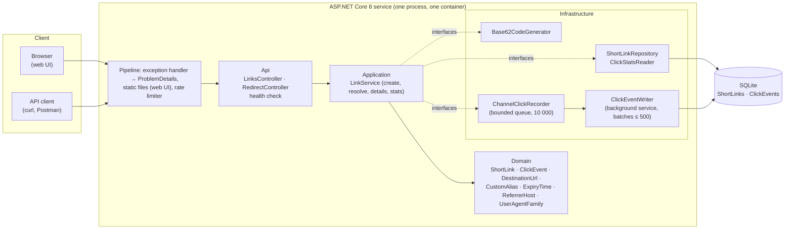
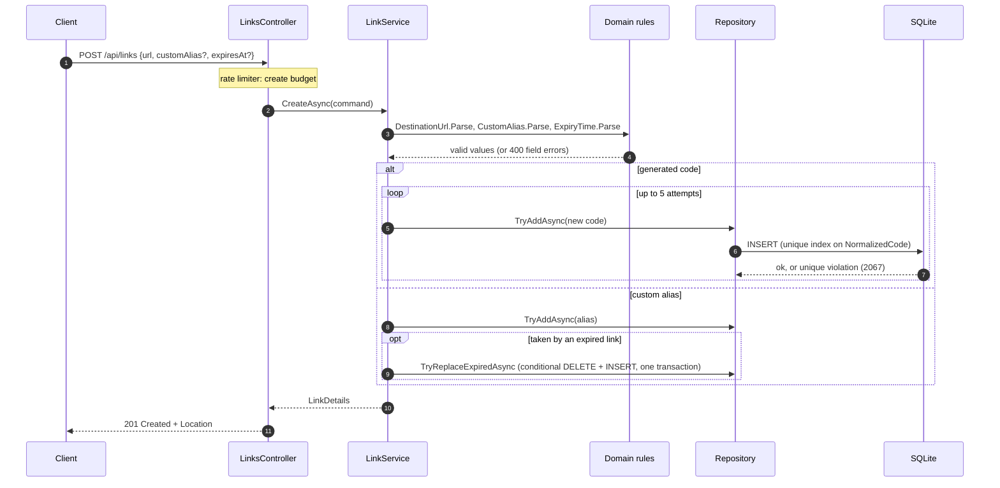
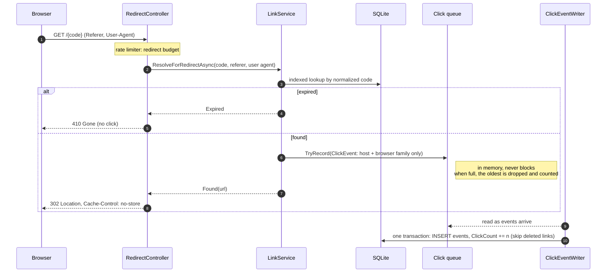
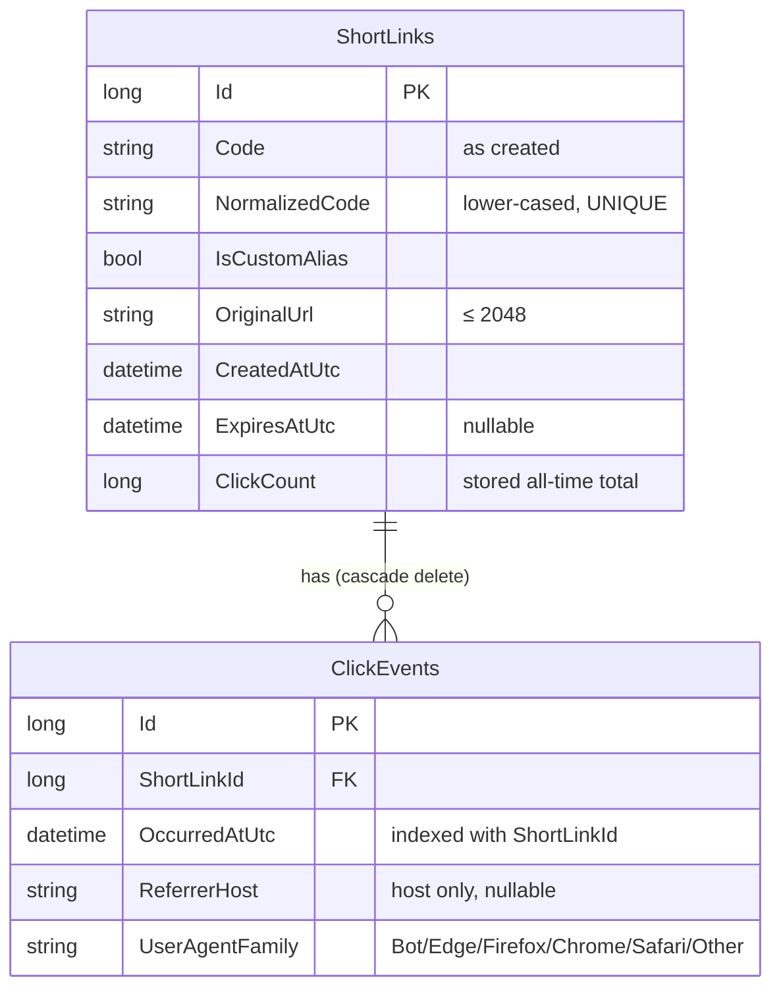
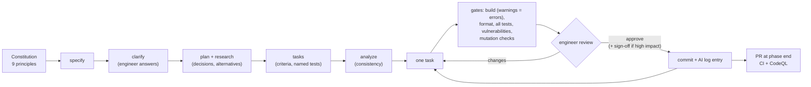

# Architecture

How the URL shortener is built, how a request flows through it, and how it was developed with an AI
agent under engineer control. Decisions and their alternatives are in the [ADRs](adr/README.md).

## Components

## Layers and the dependency rule

`Api → Application → Domain`; `Infrastructure` implements interfaces declared in `Application`.
Nothing depends on `Api`, and `Domain` has no package dependencies ([ADR-001](adr/001-architecture.md)).

| Layer | Responsibility | Does not |
|---|---|---|
| **Domain** | Rules as small types: URL validation (http/https only, no credentials, not the service itself), alias rules and reserved words, zone-required expiry, referrer reduced to a host, browser family, entity invariants | Know about HTTP, EF Core or time sources |
| **Application** | Use cases in `LinkService`: create (generated code with retries, or alias with reclaim of expired aliases), resolve for redirect (found / not found / expired, queue a click), details, statistics; interfaces for storage, code generation, click recording, statistics | Touch the database or HTTP directly |
| **Infrastructure** | EF Core + SQLite (repository, migrations, unique-index duplicate detection), cryptographic code generator, in-memory click queue and background writer, statistics queries | Contain business rules |
| **Api** | Thin controllers (HTTP ↔ use cases), ProblemDetails errors, rate-limit policies, options validation, health check, serving the built web UI | Contain business logic or data access |

## Request pipeline

Order in `Program.cs`, and why:

1. **Exception handler + status-code pages** → every error, including routing 404s, is ProblemDetails
   with a `traceId`.
2. **Static files** (`index.html` at `/`, files under `/assets`) → the web UI; no catch-all route,
   which would collide with `/{code}` ([feature 004 plan](../specs/004-web-ui/plan.md), R1).
3. **Rate limiter** → per-client budgets by endpoint attribute; a rejected request never reaches a
   controller, so it has no effect ([ADR-009](adr/009-rate-limiting.md)).
4. **Controllers** → `api/links` (create, details, stats) and `/{code}` (redirect, route-constrained
   to 3–30 safe characters); `/health`.

## Main flows

### Create a link

### Follow a link (click recorded off the redirect path)

The redirect never waits for analytics: p95 0.5–0.9 ms on the running service, and still 302 with the
writer blocked or storage failing ([ADR-005](adr/005-async-click-recording.md)).

### Statistics

`GET /api/links/{code}/stats` resolves the code with the same rules as redirects (expiry ignored),
then reads the stored total and runs two grouped queries in SQLite: clicks per UTC day for the last
30 days (padded to 30 entries) and the all-time top 5 referrer hosts, `(direct)` for none
([ADR-008](adr/008-stored-click-count.md)).

## Data model

No IP address, full referrer URL or raw user agent is stored anywhere.

## How it was built: AI-assisted, engineer-led

Sign-off points: database migrations, the redirect path, input validation and security controls, new
dependencies, data deletion. Details in [ADR-007](adr/007-spec-driven-development.md) and the
[AI usage log](ai-usage-log.md).

## Scaling path

The prototype is deliberately single-instance. To grow it:

| Today | Next step | Why |
|---|---|---|
| SQLite file | PostgreSQL on Amazon RDS / Aurora (EF Core provider switch, regenerated migrations) | Concurrent writers, replication, backups ([ADR-004](adr/004-sqlite.md)) |
| Indexed lookup per redirect | Distributed cache (Amazon ElastiCache for Redis/Valkey) for code → URL, invalidated on expiry/reclaim | Fewer database reads on the hot path |
| In-memory rate-limit budgets | Shared store (ElastiCache) plus AWS WAF rate-based rules at the edge | Budgets that hold across instances ([ADR-009](adr/009-rate-limiting.md)) |
| In-memory click queue (at-most-once) | Amazon SQS (or Kinesis at high volume) feeding a separate analytics worker and store | Durable, at-least-once analytics; independent scaling ([ADR-005](adr/005-async-click-recording.md)) |
| One container | Several ECS Fargate tasks behind an Application Load Balancer, trusted-proxy configuration, migrations as a release step | Availability and throughput ([ADR-010](adr/010-container-deployment.md)) |
| Redirects served by the API | Amazon CloudFront in front, with edge redirects for hot links | Latency close to users |
