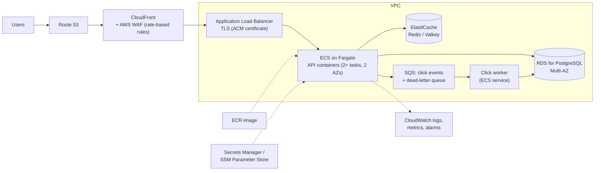
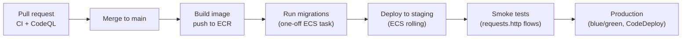

# Deployment

## Current state

The prototype **runs locally and is not deployed**: `docker compose up --build` (one container, SQLite
on a volume) or `dotnet run` (see the [README](../README.md#quick-start)). The brief requires a
prototype that runs end to end; this document describes how production would look on **AWS**
(engineer's choice) and low-cost ways to put a live demo online.

## Production design on AWS

| Concern | AWS service | How it maps to this codebase |
|---|---|---|
| Image | **Amazon ECR** | The existing [Dockerfile](../Dockerfile), built and pushed by CI |
| Compute | **ECS on Fargate**, at least two tasks across two Availability Zones | The container runs unchanged; scale on CPU or request count |
| Entry, TLS, DNS | **Application Load Balancer** with an **ACM** certificate; **Route 53** | TLS ends at the ALB (the app has no HTTPS redirect by design). **Trust forwarded headers only from the ALB** (`ForwardedHeaders` with known networks); otherwise every client shares the ALB's rate-limit budget ([ADR-009](adr/009-rate-limiting.md)) |
| Database | **RDS for PostgreSQL** (Multi-AZ, automated backups) or Aurora PostgreSQL | Replaces SQLite: switch the EF Core provider, regenerate migrations, map the unique-violation code ([ADR-004](adr/004-sqlite.md)). Run migrations as a **one-off ECS task** in the pipeline, not on startup ([ADR-010](adr/010-container-deployment.md)) |
| Click analytics | **Amazon SQS** + a worker service, with a dead-letter queue | Replaces the in-memory queue behind the existing `IClickRecorder` interface: durable, at-least-once (events need an id to deduplicate) ([ADR-005](adr/005-async-click-recording.md)) |
| Shared state | **Amazon ElastiCache** (Redis or Valkey) | Rate-limit budgets that hold across tasks; cache for code → URL on the redirect path |
| Edge | **Amazon CloudFront** (caches `/assets/*`), **AWS WAF** rate-based rules | A first, coarse abuse filter before the application's per-endpoint budgets |
| Secrets and configuration | **Secrets Manager** / **SSM Parameter Store**, injected as environment variables (`ConnectionStrings__Default`, `ShortLinks__PublicBaseUrl`, …); **IAM task roles** | Nothing in the repository or image; no long-lived keys in containers |
| Health | ALB target-group health check on `/health` | Split into `/health/live` and `/health/ready` before production (left out in feature 003) |
| Observability | **CloudWatch Logs** (structured logs), metrics and alarms on 5xx rate, p95 latency, 429 rate, "clicks dropped" / "batch failed" warnings; optionally OpenTelemetry → X-Ray | Log messages already carry codes and counts only, no client data |

### Delivery pipeline

GitHub Actions authenticates to AWS with **OpenID Connect** (an IAM role trusted for this repository),
so no AWS access keys are stored anywhere.

## Low-cost options for a live demo

| Option | Fits this repo | Catches |
|---|---|---|
| **One EC2 instance + Docker Compose** (with an EBS volume) | Closest to today: `docker compose up -d` as is; SQLite persists on the volume | You patch and run the instance; add TLS with a reverse proxy (e.g. Caddy) and configure trusted proxies |
| **Amazon Lightsail** (instance or container service) | Simple, fixed monthly price; the container runs unchanged | Container service storage is not persistent; an instance behaves like EC2 |
| **AWS App Runner** | Simplest container hosting from ECR, HTTPS included | Ephemeral disk: SQLite data resets on redeploy or restart; not free |
| **ECS Fargate + ALB** (the production shape, one task) | Realistic | ALB and Fargate have a monthly cost even when idle |

**Not a good fit:** AWS Lambda (the background click writer and in-memory budgets need a long-running
process) and S3 static hosting alone (serves the UI but cannot run the API or redirects).

AWS changed its Free Tier for new accounts in 2025 to a credit-based plan; check current terms and
pricing before creating resources.

## Rules for any deployment

- **Never commit** credentials, connection strings or tokens; use Secrets Manager / SSM and GitHub
  Actions OIDC.
- Set `ShortLinks__PublicBaseUrl` to the public HTTPS address, or short URLs will point at localhost.
- Configure **trusted proxies** before relying on rate limits behind a load balancer or proxy.
- Keep migrations a deliberate, signed-off step (constitution VIII).
