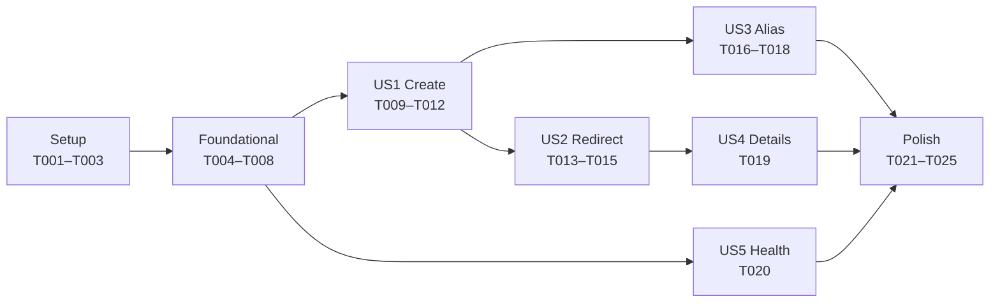

# Scenario 1: Greenfield — core URL shortener

Feature `001-greenfield-core`: build the core service from an empty solution skeleton, using
spec-driven development (GitHub Spec Kit) and AI assistance under engineer control.

| | |
|---|---|
| Spec, plan, tasks | [`specs/001-greenfield-core/`](../../specs/001-greenfield-core/) |
| Constitution | [`.specify/memory/constitution.md`](../../.specify/memory/constitution.md) |
| AI usage | [`docs/ai-usage-log.md`](../ai-usage-log.md), entries #14–#44 |
| Pull requests | #1 (spec) and #2–#10 (implementation), all merged |
| Timeline | Spec work started 2026-10-10 ~17:30 IST; last implementation commit 2026-10-11 02:49 IST |

## 1. Requirement (as given)

> Build the core of a URL shortener service.
> Users can submit a long URL and receive a short code and a short URL. They may optionally request
> a custom alias. Anyone visiting the short URL is redirected to the original URL. Each redirect is
> counted, and the owner can view the total click count for a link. The service exposes a health
> endpoint.
> Out of scope for now: user accounts, link expiry, detailed analytics, link editing, custom domains.

## 2. Interpretation and ambiguities

The prompt was turned into [spec.md](../../specs/001-greenfield-core/spec.md): 5 prioritised user
stories (create P1, redirect P1, alias P2, details P2, health P3), 27 functional requirements and
7 success criteria, each testable.

**Clarifications** (`/speckit.clarify`, 5 questions, every answer chosen by the engineer after
reviewing options and a recommendation; recorded in the spec):

| # | Question | Decision | Why it mattered |
|---|---|---|---|
| Q1 | How accurate must the click count be if recording fails? | Best-effort: the redirect never fails because counting failed | Constitution Principle V; lets feature 002 move counting off the hot path without breaking the spec |
| Q2 | Without accounts, who may see a link's stats? | Anyone with the code; auth deferred | Avoids building token management now; risk accepted because codes are random and data is low-sensitivity |
| Q3 | May aliases differ only in letter case? | No: unique ignoring case, resolve in any case; generated codes stay case-sensitive | Prevents look-alike aliases (phishing) |
| Q4 | Where does the service's own address come from? | A configured base URL; the request `Host` header is never trusted | Prevents host-header injection into returned short URLs |
| Q5 | Reject URLs with user info (`https://google.com@evil.example`)? | Yes | Classic phishing disguise; can also leak credentials |

**Engineer-raised gap during spec review:** "What if the user types `www.example.com` without
`https://`?" This produced an explicit rejection-with-hint rule and test cases for inputs that parse
with a bogus scheme (`localhost:8080` → scheme `localhost`).

**Assumptions** (spec.md, Assumptions): no deduplication (same URL → new code each time), rate
limiting deferred to the reliability feature, no scheme guessing in the API.

## 3. Impact analysis

Not applicable for greenfield: there was no existing behaviour to protect. The only pre-existing
code was the Phase 0 skeleton (`/health`, CI). Two pre-existing problems surfaced when the stricter
task gates first ran (T001) and were fixed there: High-severity vulnerable transitive packages from
the xunit 2.5.3 template, and a `dotnet format` violation. Phase 0 CI had not run those checks.

## 4. Task decomposition

[tasks.md](../../specs/001-greenfield-core/tasks.md): 25 tasks, each with acceptance criteria,
named test files, and a sign-off flag where high-impact; every task was implemented and reviewed
one at a time and committed separately.

Hand review of the generated task list fixed 4 defects before implementation (fakes created before
their interfaces existed, a test-only endpoint in production code, inconsistent validation error
keys, a reference to an untracked file). `/speckit.analyze` then found 9 issues (0 critical), all
fixed, including one that would have made the "no stack trace" security test meaningless.

## 5. Execution

| PR | Tasks | Content |
|---|---|---|
| #1 | — | Spec, clarifications, plan (research R1–R14), data model, OpenAPI contract, tasks |
| #2–#4 | T001–T003 | EF Core packages, pinned `dotnet-ef`, test project references |
| #5 | T004–T008 | Entity, abstractions, persistence + `InitialCreate` migration, host wiring, ProblemDetails |
| #6 | T009–T012 | URL validation, Base62 generator, create use case, `POST /api/links` |
| #7 | T013–T015 | Resolve + best-effort click recording, `GET /{code}`, concurrency test |
| #8 | T016–T018 | Alias rules, alias create path (409), alias race test |
| #9 | T019 | `GET /api/links/{code}` |
| #10 | T020 | Database health check |
| (pending) | T021–T025 | OpenAPI drift test, `requests.http`, quickstart validation, this document |

**Notable engineering decisions** (all approved by the engineer before commit):

- **Uniqueness lives in the database.** One unique index on a lower-cased `NormalizedCode` enforces
  every case rule atomically; inserts are attempted and duplicates detected by SQLite's
  unique-violation code (2067), never check-then-insert (research R2/R3).
- **Store the normalized URL** (`Uri.AbsoluteUri`), so the redirect target is exactly what was
  validated and .NET's parser and a browser's cannot disagree about the host.
- **Atomic click increment** (`UPDATE … SET ClickCount = ClickCount + 1`) behind `IClickRecorder`,
  with failures caught and logged by code only. The write is still synchronous: a documented,
  time-boxed deviation from constitution Principle V that feature 002 removes.
- **No dependency without a reason:** only EF Core and two Microsoft.Extensions abstraction
  packages were added, each signed off; the health check was placed in the Api project to avoid a
  third package.

**AI involvement:** 31 logged interactions for this feature: 17 accepted as generated, 14 edited,
0 rejected outright. Corrections that mattered, all caught by tests, analyzers or review before
commit:

| What the AI got wrong | How it was caught | Fix |
|---|---|---|
| Connection string read at service registration, so every test host silently shared one default database | Cross-class integration test failure (`__EFMigrationsHistory already exists`) | Lazy resolution + a guard assertion |
| A controller-wide `[Produces("application/json")]` turned framework 400s into `application/json` | Integration tests asserting `application/problem+json` | Content type declared on the 201 only |
| Missing `traceId` in error responses promised by the contract | The generic-500 integration test | Added for every ProblemDetails |
| Duplicate detection on SQLite code 19 (task text) would report NOT NULL errors as "alias taken" | Engineer-reviewed design reasoning | Extended code 2067 |
| A rejected insert stayed tracked and would be resent by the retry loop | New test; verified to fail without the fix | Detach the rejected entity |
| Assumed .NET accepts `https:\\host`; it rejects it on macOS | Unit test failure | Platform-independent test: a raw backslash is never stored |
| Click count looked like 0 in a smoke test | Investigated rather than assumed | The writes were in SQLite's WAL file; quickstart now explains how to inspect the DB |

## 6. Validation

- **Automated tests:** 131 unit + 64 integration, all passing; build with warnings as errors,
  `dotnet format` clean, no vulnerable packages.
  - Unit: domain rules (every malicious/malformed URL example in the data model, alias rules),
    use cases with hand-written fakes (forced collisions, retry exhaustion, failure isolation,
    PII-free logging), code generator.
  - Integration: the real pipeline and a real SQLite file per test host, in a production-like
    `Testing` environment (create, redirect, details, aliases, health, error format, forged `Host`
    header, OpenAPI drift).
- **Mutation checks** (temporarily breaking the code to prove a test catches it): failure
  isolation (2 tests fail), detached rejected insert, health check registration, OpenAPI drift
  (removing the 409 declaration fails 2 tests), and click counting — replacing the atomic update
  with read-then-write stored **1 click instead of 20** under 20 parallel redirects.
- **Concurrency:** 20 parallel redirects counted exactly (5/5 runs); 10 parallel claims of one
  alias → exactly one 201, nine 409, no 500 (8/8 runs).
- **Quickstart** ([quickstart.md](../../specs/001-greenfield-core/quickstart.md)), Release build on
  a fresh database: scenarios 1–12, 19/19 automated checks passed;
  [`requests.http`](../../requests.http) executed end-to-end (14/14 as expected).
- **SC-004 redirect latency:** p50 0.6 ms, **p95 0.9 ms**, p99 1.0 ms over 200 redirects after a
  20-request warm-up (target p95 < 100 ms); 223 redirects counted exactly. Apple M4, single local
  client: this measures the application's overhead, not network latency.
- **Manual (engineer):** Swagger (create, redirect, details), Postman import of the OpenAPI
  contract (400 example, 302 with redirects off), custom aliases, click counting — all as expected.

## 7. Risks and trade-offs specific to this scenario

| Risk / trade-off | Status |
|---|---|
| Synchronous click write on the redirect path (Principle V deviation) | Failure-isolated and tested; removed in feature 002 |
| Public endpoints not rate limited (Principle IV deviation) | Planned for feature 003 (reliability and abuse protection) |
| CI lacks format, vulnerability and CodeQL gates (Principle IX deviation) | Run locally per task; full CI planned |
| Public stats: anyone with a code sees its click count | Accepted (Q2); random codes, low-sensitivity data; auth later |
| No deduplication: the same URL creates many links | Accepted assumption; idempotency is a feature 003 candidate |
| One unique index on the lower-cased code: two generated codes cannot differ only in case | Accepted: ~7.8 × 10¹⁰ distinct codes remain; a collision is retried invisibly |
| SQLite: single writer, single node | Fine for the prototype; migration path to PostgreSQL via EF Core |
| Health check proves the database opens, not that the schema exists | Liveness/readiness split planned for feature 003 |

## 8. Outcome and what's next

All five user stories are implemented and verified: a user can create a short link (generated or
custom alias), anyone can follow it, every redirect is counted best-effort, details are readable,
and health reflects the database. The API matches the reviewed OpenAPI contract, enforced by a
test.

Next, in planned order: **feature 002 (brownfield)** — link expiry (410), click events and stats,
and moving click recording off the redirect path (resolving the Principle V deviation); then
**feature 003 (ambiguous: "reliable and protected from abuse")** — rate limiting, health
liveness/readiness, and related hardening.
