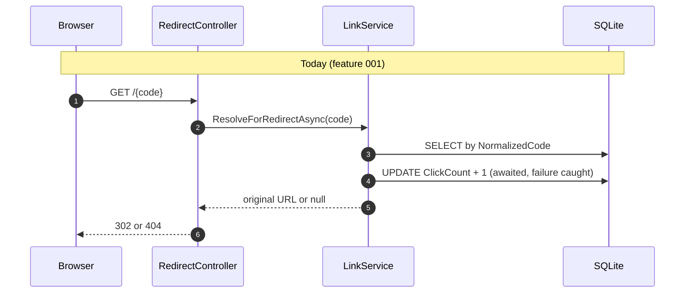
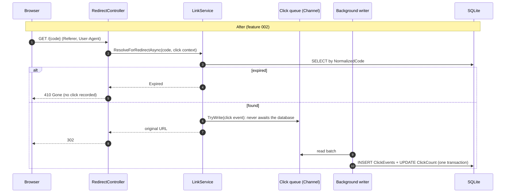
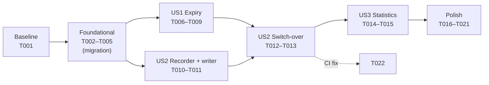

# Scenario 2: Brownfield — analytics, expiry, and an off-path click recorder

Feature `002-brownfield-analytics-expiry`: change the existing, merged greenfield service
(feature 001) safely. The impact analysis (section 3) was written **before any code** and verified by the
engineer against the code on 2026-10-11 03:05 IST. Sections 2 and 4–8 record what was then specified,
built and measured; every figure comes from a run on 2026-10-11.

## 1. Requirement (as given)

> Enhance the existing URL shortener:
> 1. Links can optionally have an expiry date. Expired links must not redirect and should return 410 Gone.
> 2. Detailed analytics: record each click event (timestamp, referrer host, coarse user agent family)
>    and expose GET /api/links/{code}/stats (new action on the existing LinksController) returning
>    total clicks, clicks per day for the last 30 days, and top 5 referrers.
> 3. Refactor: click recording must be moved off the redirect hot path so redirects stay fast and
>    never fail if analytics fails.
>
> Do not store raw IP addresses.

## 2. Interpretation & ambiguities

The prompt became [spec.md](../../specs/002-brownfield-analytics-expiry/spec.md): 3 user stories
(US1 expiry P1, US2 off-path recording P1, US3 statistics P2), 22 functional requirements (plus
FR-002a and FR-006a, added by clarifications) and
6 success criteria, one of them a regression criterion: feature 001 behaviour must not change except
where this feature says so (SC-005).

**Clarifications** (`/speckit.clarify`, 5 questions, one at a time, each with options and a
recommendation; recorded in the spec):

| # | Question | Decision | Why it mattered |
|---|---|---|---|
| Q1 | Keep `ClickCount` as a stored total or derive it from click events? | Keep it; each stored batch of events increases it in the same transaction | Links from feature 001 have totals but no events: deriving would reset them to zero ([ADR-008](../adr/008-stored-click-count.md)) |
| Q2 | When an aliased link expires, does the alias stay reserved? | **Engineer override**: it becomes reclaimable at once; the expired link and its history are retired | The AI recommended keeping it reserved (a reclaimed alias could be used to redirect old traffic elsewhere). The engineer chose reuse because an alias that never frees up defeats the point of expiry. Consequences written into FR-006a: exactly one winner when two claim at once, the code generator never targets expired codes |
| Q3 | How do clicks without a referrer appear in statistics? | As a `(direct)` source, ranked like any host | Makes "top referrers" add up; `(direct)` cannot collide with a host name |
| Q4 | Do bot and link-preview clicks count? | Yes, tagged with family `Bot` | Simple, honest totals; filtering can be added later from stored data |
| Q5 | Which expiry formats are accepted? | Any ISO 8601 date-time **with a zone** (`Z` or `±HH:mm`), stored as UTC; no zone → 400 | A zone-less time would silently be read as server-local time |

**Engineer decisions at plan time** (plan.md, "Engineer-approved decisions"): queue capacity 10 000
with `DropOldest`; reclaiming **deletes** the expired link and its events (no tombstones); request
field `expiresAt` (any zone), response field `expiresAtUtc` (always UTC). A fourth decision was taken
during T011: a new dependency, below.

**`/speckit.analyze`** found 7 issues (0 critical, 30/30 requirements covered). The high one would
have been a real bug: a reclaim deletes a link while clicks for it may still be queued, and a
foreign-key failure would then discard the writer's whole batch, other links' clicks included. Fixed
in the design before any code: the writer skips events of links that no longer exist (tested in T011).

**Assumptions** (spec): analytics is best-effort (at-most-once); days are UTC calendar days; click
events are kept indefinitely for now; for links older than this feature the daily and referrer
breakdowns can sum to less than the all-time total.

## 3. Impact analysis

Produced by reading the code on `main` at `864ec53` (feature 001 merged, PR #11) and tracing every
usage of the affected symbols (`IClickRecorder`, `RecordClickAsync`, `ResolveForRedirectAsync`,
`GetDetailsAsync`, `ClickCount`, `CreateLinkCommand`, `LinkDetails`, `LinkResponse`).

### 3.1 Data flows today vs. after

### 3.2 Modules and files

| Layer | File | Change | Why |
|---|---|---|---|
| Domain | `Links/ShortLink.cs` | Add nullable `ExpiresAtUtc`, an expiry check | Requirement 1 |
| Domain | new (e.g. `Links/ClickEvent.cs`) | Click event: link id, UTC time, referrer host, user-agent family | Requirement 2 |
| Domain | new (e.g. `Links/UserAgentFamily`, referrer-host rule) | Reduce raw headers to coarse values | Requirement 2 + "no raw IP" + least data |
| Application | `Links/CreateLinkCommand.cs` | Optional expiry | Requirement 1 |
| Application | `Links/LinkDetails.cs` | Expiry in details | Requirement 1 (visible to callers) |
| Application | `Links/ILinkService.cs`, `Links/LinkService.cs` | `ResolveForRedirectAsync` must distinguish *not found* (404) from *expired* (410) and receive click context; new stats query; expiry validated on create | Requirements 1–3 |
| Application | `Abstractions/IClickRecorder.cs` | From "record and await" to "enqueue an event"; contract becomes non-blocking | Requirement 3 |
| Application | new stats abstraction (e.g. `IClickStatsReader`) + DTO | Aggregates for the stats endpoint | Requirement 2 |
| Infrastructure | `Links/DbClickRecorder.cs` | **Replaced** by a `Channel<ClickEvent>`-based recorder (bounded, drop-oldest) + a hosted background writer (batched) | Requirement 3; resolves constitution Principle V deviation |
| Infrastructure | `Persistence/ShortLinkConfiguration.cs`, new `ClickEventConfiguration`, `AppDbContext` | `ExpiresAtUtc` column; `ClickEvents` table, FK, index `(ShortLinkId, OccurredAtUtc)` | Requirements 1–2 |
| Infrastructure | `Persistence/Migrations/` | **New migration (high-impact, sign-off)**; additive only | Constitution VIII |
| Infrastructure | `DependencyInjection.cs` | Register channel recorder (singleton), hosted writer, stats reader | Requirements 2–3 |
| Api | `Controllers/RedirectController.cs` | Pass `Referer` / `User-Agent` (never the IP); map *expired* → 410 ProblemDetails | Requirements 1–3 |
| Api | `Controllers/LinksController.cs` | New `GET {code}/stats` action; `expiresAtUtc` on create | Requirements 1–2 |
| Api | `Contracts/CreateLinkRequest.cs`, `Contracts/LinkResponse.cs`, new stats response | New fields | Requirements 1–2 |
| Api | `Program.cs` | Graceful shutdown flushes queued events (hosted service lifetime) | Requirement 3 |

### 3.3 Endpoints

| Endpoint | Change | Compatibility |
|---|---|---|
| `POST /api/links` | Optional `expiresAtUtc` (must be in the future) | Additive: existing requests unchanged |
| `GET /{code}` | New **410 Gone** for expired links; click recording asynchronous | 302/404 unchanged for existing links (no expiry) |
| `GET /api/links/{code}` | Response gains `expiresAtUtc` (null when none) | Additive field. **Breaks the T019 "exactly five fields" test by design**: update it in the same task |
| `GET /api/links/{code}/stats` | **New** | — |
| `/health` | Unchanged | — |

### 3.4 Schema

| Table | Change | Data safety |
|---|---|---|
| `ShortLinks` | Add `ExpiresAtUtc` TEXT **NULL** | Additive; existing rows get NULL = never expire |
| `ClickEvents` (new) | `Id`, `ShortLinkId` (FK → `ShortLinks.Id`), `OccurredAtUtc`, `ReferrerHost` (nullable), `UserAgentFamily`; index `(ShortLinkId, OccurredAtUtc)` | New table; no existing data touched |

`ShortLinks.ClickCount` already holds real counts. Whether it stays a stored counter (updated by the
writer) or becomes derived from `ClickEvents` is an **ADR decision**. If it were derived, existing
counts would be lost unless back-filled, because there are no historical events.

### 3.5 Tests

| Test | Impact |
|---|---|
| `UnitTests/Application/ResolveLinkTests.cs` (9 tests) | **Signature change**: `ResolveForRedirectAsync` result type and click context; failure-isolation intent unchanged |
| `UnitTests/Fakes/FakeClickRecorder.cs` | Follows the new `IClickRecorder` contract |
| `UnitTests/Application/CreateLink*Tests.cs` | `CreateLinkCommand` gains expiry; existing cases unchanged in behaviour |
| `IntegrationTests/RedirectTests.cs` → `EachRedirectIsCounted` | **Behaviour change**: the count becomes eventually consistent (FR-015 "within 5 seconds"); the test must wait for the background flush instead of reading immediately |
| `IntegrationTests/ConcurrencyTests.cs` → `ConcurrentRedirectsAreAllCounted` | Same: waits for the flush. The exact-count guarantee (no lost increments) must still hold under normal load |
| `IntegrationTests/LinkDetailsTests.cs` → `ShowsClickCount…`, `NewLinkHasExactlyTheContractFields…` | Wait for the flush; field list gains `expiresAtUtc` |
| `IntegrationTests/RedirectTests.cs` → `RedirectStillWorksWhenClickRecordingFails` | Still valid; the failure point moves to enqueue/writer |
| `IntegrationTests/Persistence/ShortLinkRepositoryTests.cs` → `ClickRecorderIncrementsStoredCount` | Replaced by tests of the background writer |
| `IntegrationTests/OpenApiContractTests.cs` | Expected table gains the stats operation, 410, and new fields, with `contracts/openapi.yaml` updated together |
| All other feature 001 tests | Expected to pass **unchanged**; that is the regression baseline (131 unit + 64 integration on `main`) |

### 3.6 Documentation and contract

`specs/001-greenfield-core/contracts/openapi.yaml` is feature 001's contract. Feature 002 gets its
own spec folder with an updated contract. Also affected: `requests.http`, the quickstart, the
`docs/ai-usage-log.md` entries, and new ADRs (stored vs. derived `ClickCount`; at-most-once
delivery of the click queue).

### 3.7 Risks surfaced by the analysis

| Risk | Mitigation to carry into the plan |
|---|---|
| Queued clicks lost on crash or when the bounded queue is full (at-most-once) | Accept and document (ADR); log dropped events; flush on graceful shutdown |
| Counts lag behind redirects | Spec already allows "within 5 seconds" (FR-015); tests wait for the flush with a timeout |
| SQLite write contention from batched inserts | One writer, batched transactions; a single-writer design suits SQLite |
| Referrer or user agent leaking personal data | Store only the referrer **host** and a coarse family; never the IP, full referrer URL, or raw user agent |
| Changing the `IClickRecorder` contract breaks callers | Only `LinkService` and test fakes use it (traced above) |
| Expired links still counted or cached | 410 path records no click; `Cache-Control: no-store` already on redirects |

## 4. Task decomposition

[tasks.md](../../specs/002-brownfield-analytics-expiry/tasks.md): 20 planned tasks plus 2 added during
implementation (T021, T022), each with acceptance criteria, named test files, the feature 001 tests
it is allowed to change (with the reason), and a sign-off flag where high-impact.

Brownfield-specific choices in the decomposition:

- **Regression baseline first** (T001): the whole feature 001 suite was run and recorded before any
  code change, so every later change could be checked against it.
- **Build beside, then switch once.** The channel recorder (T010) and the background writer (T011)
  were built and tested while the old synchronous recorder still did the counting; one task (T012)
  switched the redirect over and removed the old code. Counting never broke between commits.
- **One reviewed schema change.** The domain gained `ExpiresAtUtc` in T002, but EF Core was told to
  ignore it until T005 added the column, the `ClickEvents` table and the mapping in one signed-off
  migration.

## 5. Execution

| PR | Tasks | Content |
|---|---|---|
| #12 | — | Impact analysis (§3), spec with 5 clarifications, plan (research R1–R11), data model, OpenAPI contract v0.2.0, tasks |
| #13 | T001–T005 | Regression baseline; `ShortLink` expiry; `ReferrerHost` / `UserAgentFamily` privacy rules; `ClickEvent`; migration `AddExpiryAndClickEvents` |
| #14 | T006–T009 | `expiresAt` rule; `RedirectResolution` (Found / NotFound / Expired); 410 Gone; atomic reclaim of expired aliases |
| #15 | T010–T013, T022 | Bounded channel recorder; background writer; redirect switch-over; resilience tests; the CI fix (T022) |
| #16 | T014–T015 | Statistics reader; `GET /api/links/{code}/stats` |
| (this PR) | T016–T021 | ADR-005, ADR-008; `requests.http`; Swagger examples; quickstart validation; this document; close-out |

**High-impact sign-offs** (all given by the engineer before the commit): migration (T005), input
validation (T006), redirect path (T008, T012), data deletion and concurrency (T009), new dependency
(T011).

**Notable engineering decisions:**

- **Privacy is enforced at the edge of the Domain.** `ClickEvent.Create` takes the raw `Referer` and
  `User-Agent` and keeps only the lower-cased host and one of six browser families; the entity has
  no field that could hold the raw values or an IP, and the controller passes only those two headers.
- **Expiry input is kept as text** until the Domain checks it, because binding it to a date type
  would read `2026-12-31T23:59:00` (no zone) as server-local time without complaint.
- **Reclaim safety rests on the database.** One transaction deletes the old link only if it is still
  that link and still expired, then inserts the new one; Microsoft.Data.Sqlite starts transactions
  as `IMMEDIATE`, so concurrent claims queue for the write lock and only one can delete the row.
- **One new dependency, signed off:** `Microsoft.Extensions.Hosting.Abstractions` 8.0.1 for
  `BackgroundService` in the Infrastructure library. The plan had said "no new packages"; that was
  true for the Api project (ASP.NET Core shared framework) but not for the class library. Rejected
  alternatives: a host wrapper in the Api, a framework reference (plan.md decision 4).
- **Statistics aggregate in the database.** Research R7 flagged that EF Core might not translate
  date grouping for SQLite; the generated SQL showed it does (`strftime(..., 'start of day')` +
  `GROUP BY`), so the in-memory fallback was not needed.

**AI involvement:** 26 logged interactions for this feature (#47–#72): 10 accepted as generated,
16 edited, 0 rejected outright. Corrections that mattered:

| What the AI got wrong | How it was caught | Fix |
|---|---|---|
| Task plan added a public property (T002) before its column existed: EF Core maps public properties by convention, so 26 integration tests failed with `no such column` | Full-suite gate on the task | EF `Ignore` until the T005 migration; one reviewed schema change, every commit green |
| Plan said `BackgroundService` needed no package | Build of the Infrastructure library (T011) | Engineer chose the package among three options (dependency sign-off) |
| T011's shutdown test queued two clicks at once; locally the writer always took both in one batch | **A flaky CI run** on PR #15 (attempt 1 failed, attempt 2 passed), reported by the engineer | The writer was really logging the loss in pieces and counting the queued click twice; deterministic test first (failed 3/3), then fix (T022) |
| The in-memory test repository gave every link id 0 | The T004 guard in `ClickEvent.Create` rejected id 0 during T012 | Fake now assigns ids like the database |
| "No click after 410" checked immediately, which proves nothing once storage is asynchronous | Self-review in T012 | A later "marker" click is awaited first; the queue is first in, first out |
| "Today" from server-local time could not fail on a UTC CI runner | Self-review in T015 | Test clock pins a UTC+14 local zone |
| Swagger showed `string` placeholders: feature 001's `<example>` tags were never wired up | Engineer's manual test in T008 sent `"customAlias": "string"` | New task T021 |
| Three requirement numbers in code comments were wrong | Cross-checking the spec while writing the ADRs | Corrected in T016 |

### Constitution Principle V deviation closed (T012, 2026-10-11)

Feature 001 recorded one deviation from Principle V ("the redirect path must be fast and must not
fail because analytics fails"): each redirect awaited a synchronous `UPDATE ... ClickCount + 1`
(`DbClickRecorder`), with failures caught but the database still on the hot path. T012 removed it:

- The redirect now builds a privacy-reduced `ClickEvent` (referrer host and browser family only; the
  client IP never reaches the Application layer) and calls the non-blocking
  `IClickRecorder.TryRecord`, an in-memory enqueue into a bounded channel (10 000, drop-oldest).
- The hosted `ClickEventWriter` stores events and increases `ClickCount` in batched transactions.
  Storage failures are logged and discarded there (at-most-once, ADR-005); they cannot reach the
  redirect.
- Evidence: integration tests show a redirect still returns 302 when the recorder throws and when
  storage throws (failure logged); writer tests show batches, deleted-link filtering, failure
  recovery and shutdown flush. T013 adds the overload proof: redirects complete while the writer is
  blocked.
- Trade-off accepted by the engineer: counts are eventually consistent (within 5 seconds, FR-012),
  so feature 001 tests that read a count straight after redirecting now wait for it (tasks.md T012,
  "Changed tests").

## 6. Validation

### Regression baseline (T001)

Recorded on branch `002-brownfield-analytics-expiry` at `9ca50d7`, before any code change
(2026-10-11 03:51 IST): build 0 warnings / 0 errors; **131 unit + 64 integration tests passing,
0 failing**, identical to `main` after feature 001. From here on every task runs the full suite; a
feature 001 test may change only where tasks.md lists it under "Changed tests".

### Final results

- **Automated tests:** **244 unit + 114 integration**, all passing (baseline 131 + 64; +113 / +50);
  Release build with warnings as errors, `dotnet format` clean, no vulnerable packages, CI green.
- **Feature 001 tests that changed, and why** (each listed in tasks.md before it changed):

| Test | Change | Reason |
|---|---|---|
| `ResolveLinkTests` (9) | Assert on `RedirectResolution` instead of a string; pass a `ClickContext`; two cancellation tests reworked | Signature change (T007); recording no longer awaits or takes a token (T012). Same behaviour |
| `RedirectTests.EachRedirectIsCounted`, `ConcurrencyTests.ConcurrentRedirectsAreAllCounted`, `LinkDetailsTests.ShowsClickCount…` | Wait for the count with `Eventually` (≤ 5 s) | Counts are stored in the background (FR-012). Exact counts (3; 20 concurrent) unchanged |
| `LinkDetailsTests.NewLinkHasExactlyTheContractFields…` | Five fields → six (`expiresAtUtc`) | Additive response field |
| `RedirectTests.RedirectStillWorksWhenClickRecordingFails` | The failing recorder throws from `TryRecord` | New recorder contract; same intent |
| `ShortLinkRepositoryTests.ClickRecorderIncrementsStoredCount` | Removed | The recorder it tested is gone; `ClickEventWriterTests` cover storing events and totals |
| `OpenApiContractTests` | Contract v0.2.0: new fields, stats operation, response schemas, examples, summaries | Contract change; drift test now points at feature 002's contract |
| Test fakes (`FakeClickRecorder`, `InMemoryShortLinkRepository`, `FixedTimeProvider`) and the six service helpers | New contract; reclaim; positive ids; cancellation; pinned local zone; stats reader argument | Support only |

Every other feature 001 test passed **unchanged**.

- **Mutation checks** (break the code on purpose, confirm a test fails), for example: a reclaim delete
  without the "still expired" condition; no transaction around the reclaim; deleting whatever link
  holds the code (fails the 10-way race test); a writer that stops after a failed batch; stopping
  that aborts writes; a recorder that waits for queue space (fails the blocked-writer test);
  `DropNewest`; "today" from local time. Two survivors are recorded rather than hidden: the final
  flush (covered by the drain loop except in a race too narrow to test reliably) and a stats window
  starting a day early (an equivalent mutant: padding discards the extra day).
- **Concurrency:** 20 parallel redirects still counted exactly; 10 parallel claims of one expired
  alias → exactly one 201, nine 409, no 500 (8/8 repeated runs).
- **Analytics impaired** (in-process, `AnalyticsResilienceTests`): writer blocked in storage with a
  queue of 10 → 49 further redirects all 302 while nothing was stored, p95 0.35–0.73 ms over 5 runs;
  the blocked click plus the 10 newest stored afterwards and "39 queued clicks were dropped" logged.
  Storage failing on every batch → 50 of 50 redirects 302.
- **Quickstart on real feature 001 data** (T018): the feature 001 app (`864ec53`) created a database
  (a link with 3 clicks, an alias); the current app migrated it on startup. Scenarios 1–10 all as
  expected: the old link still redirected and its count went 3 → 4 with `expiresAtUtc` null; a
  `+05:30` expiry was stored as UTC; 302 before and 410 (`no-store`, count unchanged) after expiry;
  reclaim gave a fresh link; statistics showed total 5, today 5, `news.example` 3, `(direct)` 2; the
  count had caught up by the first read (~8 ms); `ClickEvents` held only id, link, time, host and
  family.
- **Redirect latency on the running app (SC-002):** p50 0.3 ms, **p95 0.5 ms**, p99 0.6 ms, max
  0.7 ms over 200 redirects after a 20-request warm-up (curl, Apple M4; feature 001 measured p95
  0.9 ms with the synchronous write). 220 of 220 clicks counted; 225 stored events = stored total 225.
- **`requests.http`:** all 29 requests (both features) executed top to bottom against the running app
  on a fresh database, 29/29 as expected, including the 410 after a one-minute expiry.
- **Manual (engineer):** Swagger (pre-filled examples, validation messages, statistics, summaries)
  and Postman (v0.2.0 contract import, 302 with a `Referer`, 410 after expiry, statistics), all as
  expected.

### Before and after

| Behaviour | Feature 001 | After feature 002 |
|---|---|---|
| Create a link | `url`, optional `customAlias` | Also optional `expiresAt` (zone required, future only) |
| Link response | 5 fields | 6 fields: + `expiresAtUtc` (null = never) |
| Follow a link | 302; count updated synchronously in the request | 302; click queued in memory, stored in the background; **410 Gone** once expired |
| Click count | Exact immediately | Exact within about a second (≤ 5 s guaranteed); at-most-once under failure |
| Per-click data | None | Time, referrer host, browser family; never IP, path, query or raw user agent |
| Statistics | — | `GET /api/links/{code}/stats`: total, 30 UTC days, top 5 referrers; also for expired links |
| Alias of an expired link | — | Can be claimed again; the old link and its history are deleted |
| Analytics storage failing | Redirect still 302 (failure caught), but waited on the database | Redirect never touches the database; losses logged as counts |

### Migration and rollback

**Upgrade.** One additive migration, `AddExpiryAndClickEvents`: `ShortLinks.ExpiresAtUtc` (nullable)
and the `ClickEvents` table with a cascade foreign key and a `(ShortLinkId, OccurredAtUtc)` index. It
runs on startup in Development or with `Database:MigrateOnStartup=true`; otherwise
`dotnet ef database update --project src/UrlShortener.Infrastructure --startup-project src/UrlShortener.Api`.
Existing links keep their data and never expire (migration test on a seeded database; T018 on a real
one).

**Rollback, both paths tested on 2026-10-11** with a database holding feature 002 data:

1. **Code only** (redeploy feature 001, keep the database): works without errors (302, details,
   create, synchronous counting), because the schema change is additive and EF Core reads only the
   columns it maps. Cost: **expired links redirect again** (the old code ignores expiry) and no click
   events are recorded until feature 002 is back.
2. **Database too**: `dotnet ef database update 20261010190734_InitialCreate --connection "Data Source=<file>"`
   (same `--project` / `--startup-project`). Reverting keeps every link and its total; it drops
   `ClickEvents` (all click history) and the expiry column (all expiries). Back up the file first
   (copy it with the app stopped, or include the `-wal` file).

## 7. Risks and trade-offs specific to this scenario

| Risk / trade-off | Status |
|---|---|
| Clicks can be lost: queue full, failed batch, shutdown budget exceeded, crash | Accepted, at-most-once ([ADR-005](../adr/005-async-click-recording.md)); every loss except a crash is logged as a count |
| Counts are eventually consistent | Within about a second in practice; ≤ 5 s required (FR-012) |
| Queue lives in one process | Single instance only; scaling out needs a shared queue and a database with concurrent writers |
| Stored total is denormalised | Kept consistent by one transaction in `ClickEventStore`, the only writer ([ADR-008](../adr/008-stored-click-count.md)) |
| Older links: breakdowns sum to less than the total | Documented in spec, contract and ADR-008 |
| Reclaimed aliases can send old traffic somewhere new | Accepted by the engineer (Q2 override); history is deleted so it cannot be attributed to the new owner |
| Click events are kept indefinitely | Retention policy is future work (spec assumption) |
| EF Core logs an error line for every expected duplicate insert (each 409 and each reclaim) | Log noise, not a failure; filter or downgrade in a later change |
| Statistics are public to anyone with the code | Unchanged from feature 001 Q2: random codes, aggregates only, no per-visitor data |
| Rate limiting (Principle IV) and full CI gates (Principle IX) | Still deferred to feature 003 and Phase 5; Principle V's deviation is **closed** |

## 8. Outcome and what's next

All three user stories are implemented and verified on a database created by feature 001: links can
expire (410 Gone, details and statistics still readable), expired aliases can be reclaimed safely
under concurrency, every redirect produces a privacy-reduced click event, statistics report totals,
30 days and top referrers, and the redirect no longer touches the database (p95 0.5 ms; still 302
with analytics blocked or failing). Feature 001 behaviour is unchanged apart from the documented,
intended changes in §6.

Next, in planned order: **feature 003 (ambiguous: "reliable and protected from abuse")**: rate
limiting, health liveness/readiness, and hardening; candidates surfaced here: quieter logging for
expected duplicates, a click-event retention policy, and the CI gates (format, vulnerable packages,
CodeQL; pin the runner image).