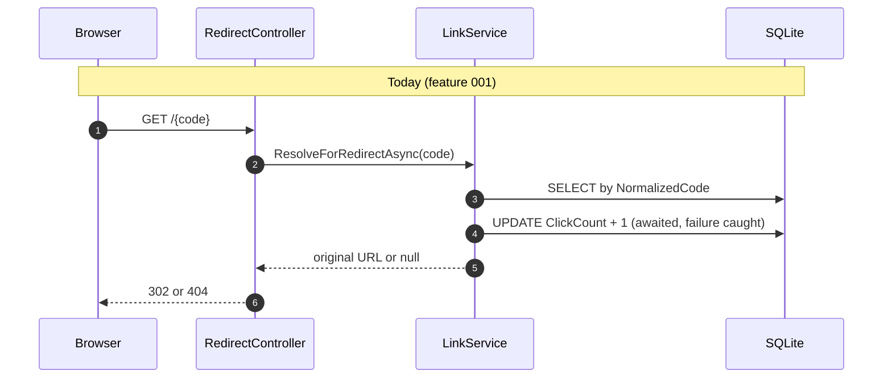
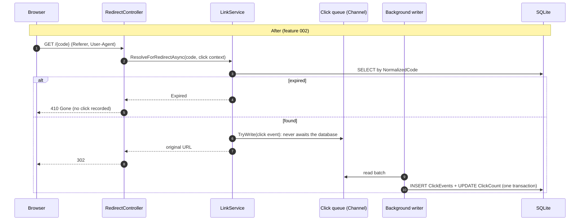

# Scenario 2: Brownfield — analytics, expiry, and an off-path click recorder

Feature `002-brownfield-analytics-expiry`: change the existing, merged greenfield service
(feature 001) safely. The impact analysis (section 3) was written **before any code** and verified by the
engineer against the code on 2026-10-11 03:05 IST. Later sections are completed as the work proceeds.

## 1. Requirement (as given)

> Enhance the existing URL shortener:
> 1. Links can optionally have an expiry date. Expired links must not redirect and should return 410 Gone.
> 2. Detailed analytics: record each click event (timestamp, referrer host, coarse user agent family)
>    and expose GET /api/links/{code}/stats (new action on the existing LinksController) returning
>    total clicks, clicks per day for the last 30 days, and top 5 referrers.
> 3. Refactor: click recording must be moved off the redirect hot path so redirects stay fast and
>    never fail if analytics fails.
>
> Do not store raw IP addresses.

## 2. Interpretation & ambiguities

*(Completed during `/speckit.specify` and `/speckit.clarify`.)*

## 3. Impact analysis

Produced by reading the code on `main` at `864ec53` (feature 001 merged, PR #11) and tracing every
usage of the affected symbols (`IClickRecorder`, `RecordClickAsync`, `ResolveForRedirectAsync`,
`GetDetailsAsync`, `ClickCount`, `CreateLinkCommand`, `LinkDetails`, `LinkResponse`).

### 3.1 Data flows today vs. after

### 3.2 Modules and files

| Layer | File | Change | Why |
|---|---|---|---|
| Domain | `Links/ShortLink.cs` | Add nullable `ExpiresAtUtc`, an expiry check | Requirement 1 |
| Domain | new (e.g. `Links/ClickEvent.cs`) | Click event: link id, UTC time, referrer host, user-agent family | Requirement 2 |
| Domain | new (e.g. `Links/UserAgentFamily`, referrer-host rule) | Reduce raw headers to coarse values | Requirement 2 + "no raw IP" + least data |
| Application | `Links/CreateLinkCommand.cs` | Optional expiry | Requirement 1 |
| Application | `Links/LinkDetails.cs` | Expiry in details | Requirement 1 (visible to callers) |
| Application | `Links/ILinkService.cs`, `Links/LinkService.cs` | `ResolveForRedirectAsync` must distinguish *not found* (404) from *expired* (410) and receive click context; new stats query; expiry validated on create | Requirements 1–3 |
| Application | `Abstractions/IClickRecorder.cs` | From "record and await" to "enqueue an event"; contract becomes non-blocking | Requirement 3 |
| Application | new stats abstraction (e.g. `IClickStatsReader`) + DTO | Aggregates for the stats endpoint | Requirement 2 |
| Infrastructure | `Links/DbClickRecorder.cs` | **Replaced** by a `Channel<ClickEvent>`-based recorder (bounded, drop-oldest) + a hosted background writer (batched) | Requirement 3; resolves constitution Principle V deviation |
| Infrastructure | `Persistence/ShortLinkConfiguration.cs`, new `ClickEventConfiguration`, `AppDbContext` | `ExpiresAtUtc` column; `ClickEvents` table, FK, index `(ShortLinkId, OccurredAtUtc)` | Requirements 1–2 |
| Infrastructure | `Persistence/Migrations/` | **New migration (high-impact, sign-off)**; additive only | Constitution VIII |
| Infrastructure | `DependencyInjection.cs` | Register channel recorder (singleton), hosted writer, stats reader | Requirements 2–3 |
| Api | `Controllers/RedirectController.cs` | Pass `Referer` / `User-Agent` (never the IP); map *expired* → 410 ProblemDetails | Requirements 1–3 |
| Api | `Controllers/LinksController.cs` | New `GET {code}/stats` action; `expiresAtUtc` on create | Requirements 1–2 |
| Api | `Contracts/CreateLinkRequest.cs`, `Contracts/LinkResponse.cs`, new stats response | New fields | Requirements 1–2 |
| Api | `Program.cs` | Graceful shutdown flushes queued events (hosted service lifetime) | Requirement 3 |

### 3.3 Endpoints

| Endpoint | Change | Compatibility |
|---|---|---|
| `POST /api/links` | Optional `expiresAtUtc` (must be in the future) | Additive: existing requests unchanged |
| `GET /{code}` | New **410 Gone** for expired links; click recording asynchronous | 302/404 unchanged for existing links (no expiry) |
| `GET /api/links/{code}` | Response gains `expiresAtUtc` (null when none) | Additive field. **Breaks the T019 "exactly five fields" test by design**: update it in the same task |
| `GET /api/links/{code}/stats` | **New** | — |
| `/health` | Unchanged | — |

### 3.4 Schema

| Table | Change | Data safety |
|---|---|---|
| `ShortLinks` | Add `ExpiresAtUtc` TEXT **NULL** | Additive; existing rows get NULL = never expire |
| `ClickEvents` (new) | `Id`, `ShortLinkId` (FK → `ShortLinks.Id`), `OccurredAtUtc`, `ReferrerHost` (nullable), `UserAgentFamily`; index `(ShortLinkId, OccurredAtUtc)` | New table; no existing data touched |

`ShortLinks.ClickCount` already holds real counts. Whether it stays a stored counter (updated by the
writer) or becomes derived from `ClickEvents` is an **ADR decision**. If it were derived, existing
counts would be lost unless back-filled, because there are no historical events.

### 3.5 Tests

| Test | Impact |
|---|---|
| `UnitTests/Application/ResolveLinkTests.cs` (9 tests) | **Signature change**: `ResolveForRedirectAsync` result type and click context; failure-isolation intent unchanged |
| `UnitTests/Fakes/FakeClickRecorder.cs` | Follows the new `IClickRecorder` contract |
| `UnitTests/Application/CreateLink*Tests.cs` | `CreateLinkCommand` gains expiry; existing cases unchanged in behaviour |
| `IntegrationTests/RedirectTests.cs` → `EachRedirectIsCounted` | **Behaviour change**: the count becomes eventually consistent (FR-015 "within 5 seconds"); the test must wait for the background flush instead of reading immediately |
| `IntegrationTests/ConcurrencyTests.cs` → `ConcurrentRedirectsAreAllCounted` | Same: waits for the flush. The exact-count guarantee (no lost increments) must still hold under normal load |
| `IntegrationTests/LinkDetailsTests.cs` → `ShowsClickCount…`, `NewLinkHasExactlyTheContractFields…` | Wait for the flush; field list gains `expiresAtUtc` |
| `IntegrationTests/RedirectTests.cs` → `RedirectStillWorksWhenClickRecordingFails` | Still valid; the failure point moves to enqueue/writer |
| `IntegrationTests/Persistence/ShortLinkRepositoryTests.cs` → `ClickRecorderIncrementsStoredCount` | Replaced by tests of the background writer |
| `IntegrationTests/OpenApiContractTests.cs` | Expected table gains the stats operation, 410, and new fields, with `contracts/openapi.yaml` updated together |
| All other feature 001 tests | Expected to pass **unchanged**; that is the regression baseline (131 unit + 64 integration on `main`) |

### 3.6 Documentation and contract

`specs/001-greenfield-core/contracts/openapi.yaml` is feature 001's contract. Feature 002 gets its
own spec folder with an updated contract. Also affected: `requests.http`, the quickstart, the
`docs/ai-usage-log.md` entries, and new ADRs (stored vs. derived `ClickCount`; at-most-once
delivery of the click queue).

### 3.7 Risks surfaced by the analysis

| Risk | Mitigation to carry into the plan |
|---|---|
| Queued clicks lost on crash or when the bounded queue is full (at-most-once) | Accept and document (ADR); log dropped events; flush on graceful shutdown |
| Counts lag behind redirects | Spec already allows "within 5 seconds" (FR-015); tests wait for the flush with a timeout |
| SQLite write contention from batched inserts | One writer, batched transactions; a single-writer design suits SQLite |
| Referrer or user agent leaking personal data | Store only the referrer **host** and a coarse family; never the IP, full referrer URL, or raw user agent |
| Changing the `IClickRecorder` contract breaks callers | Only `LinkService` and test fakes use it (traced above) |
| Expired links still counted or cached | 410 path records no click; `Cache-Control: no-store` already on redirects |

## 4. Task decomposition

*(Link to tasks.md once generated.)*
