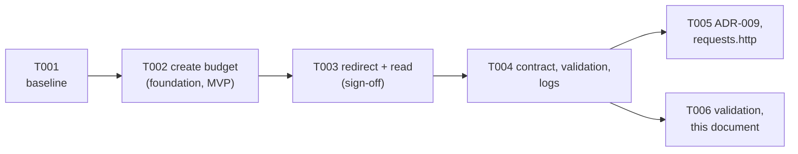

# Scenario 3: Ambiguous — "reliable and protected from abuse"

Feature `003-reliability-abuse-protection`. The requirement below is deliberately vague. This
document records how it was interpreted **before** any specification or code: what is ambiguous,
what a product owner would be asked, what was assumed because no product owner was available, and
the measurable problem that was actually built, then how it was specified, built and validated.
Every figure comes from a run on 2026-10-11.

## 1. Requirement (as given)

> "The service should be reliable and protected from abuse."

## 2. Interpretation

### 2.1 What is ambiguous

| Word | Open questions |
|---|---|
| **reliable** | Against what: traffic spikes, a slow or failing database, process crashes, restarts and deploys, bad input? Measured how: availability target, error rate, latency? For which endpoints: the public redirect, the create API, both? |
| **protected** | By what means: limiting request rates, blocking bad destinations, authentication, CAPTCHAs? Enforced where: in the service, at a proxy or CDN? |
| **abuse** | By whom and how: spammers mass-creating links to malicious sites, bots enumerating short codes or scraping statistics, a single client flooding redirects (denial of service), tools retrying aggressively? |
| **the service** | All endpoints, or only the public ones? One instance or several? Behind a reverse proxy? |
| (unstated) | Scale: requests per second to plan for, how many distinct clients, and what a legitimate heavy user looks like |

### 2.2 Questions for a product owner

1. Which failures matter most: traffic spikes, a database outage, crashes during deploys? Is there an availability or latency target?
2. Who are the abusers we worry about: link spammers, code enumerators and scrapers, or someone trying to take the redirect down?
3. What traffic should one instance handle, and what does a legitimate heavy user look like (for example an internal tool creating links in bulk)?
4. Should limits apply per client IP, per API key or account (none exist today), or globally?
5. What should a throttled client see, and may any clients be exempt (internal tools, health probes)?
6. Is blocking malicious **destinations** in scope (a maintained blocklist, an external reputation service), and who maintains such a list?
7. Do clients retry creates in a way that produces duplicate links, so that idempotency matters?
8. What does operations need from health checks (liveness vs readiness for an orchestrator)?
9. Will the service run behind a reverse proxy or CDN? That decides how a client is identified.
10. Are there privacy constraints on using client IP addresses for throttling? Feature 002 already forbids storing them.

### 2.3 Assumptions (no product owner available)

- **Primary abuse** is volume from a single client: mass link creation (spam, filling the code
  space) and floods against the public redirect and read endpoints (enumeration, scraping, denial of
  service). Malicious destinations matter too, but a credible defence needs a maintained reputation
  source, which is out of scope (below).
- **Reliable** here means the service keeps serving legitimate clients when one client misbehaves,
  and rejects the excess quickly and clearly instead of slowing down for everyone. Reliability
  against slow or failing analytics storage was already delivered in feature 002 (redirects never
  touch the database; p95 0.5 ms), as were consistent ProblemDetails errors without stack traces and
  a database health check (feature 001).
- **Clients are identified by IP address**, used in memory only as the rate-limiter key: never
  stored, never logged (consistent with feature 002 FR-010). There are no accounts or API keys.
- **Single instance**, exposed directly, with no reverse proxy rewriting client addresses. Behind a
  proxy, forwarded headers would have to be configured with the proxy's address first; otherwise every
  client would share one limit.
- **Limits are configuration, not code.** Defaults (to be confirmed in the spec): creating links
  much stricter than following them, because creation has lasting cost and is the spam vector, while
  a burst of legitimate redirects (a link shared in a chat) is normal.
- **Health probes are never throttled**, so an orchestrator never mistakes throttling for an outage.

### 2.4 Normalized problem statement

> Protect the public endpoints from single-client overuse so that one client cannot degrade the
> service for others: each client (identified by IP address, held in memory only) gets its own
> request budget per endpoint group — **create** (strict), **redirect** (generous, bursts allowed)
> and **read** (details and statistics) — and requests beyond the budget are rejected immediately
> with **429 Too Many Requests**, a `Retry-After` header and a ProblemDetails body. Limits are
> configurable; health checks are never limited; rejections are logged without client identity.

**Measurable acceptance criteria** (the spec turns these into numbered requirements):

1. A client that exceeds the create budget receives 429 with `Retry-After` (whole seconds, ≥ 1) and
   an `application/problem+json` body; no link is created by a rejected request.
2. Once the window has passed, the same client succeeds again.
3. Another client is unaffected while the first is throttled.
4. Redirect and read budgets are enforced separately from create: exhausting create does not block
   following links, and the reverse.
5. `/health` is never rate limited.
6. Rejections are logged with the policy name and no IP address; no IP address is stored.
7. Under the redirect budget, redirect latency is unchanged (p95 under 100 ms, SC-002 of feature 002).

### 2.5 Scope chosen, and what was deliberately left out

**Built:** rate limiting with ASP.NET Core's built-in rate limiter (named policies on the create,
redirect and read endpoints, 429 + `Retry-After` + ProblemDetails). It is the direct answer to
"protected from abuse", the constitution's Principle IV requires it ("Public endpoints MUST be rate
limited"), and it closes the deviation carried since feature 001.

**Left out, with reasons** (engineer decision on 2026-10-11, with the submission deadline the same day):

| Candidate | Why not now |
|---|---|
| Health liveness vs readiness | `/health` already checks the database; the split only matters to an orchestrator, which arrives with Docker in Phase 5. Next candidate |
| Destination domain blocklist | A static list in configuration gives a false sense of safety; a real defence needs a maintained reputation feed (an external dependency). The existing URL rules already block non-http(s) schemes, credentials in URLs and links back to the shortener |
| Idempotent create (`Idempotency-Key`) | No client is known to retry creates; doing it properly needs key storage, expiry and an ADR. Duplicate links are harmless apart from using codes |
| In-memory cache for hot redirects | Performance rather than reliability: redirects already take 0.5 ms at p95 |
| Structured logging with a correlation ID | ProblemDetails already carry a `traceId`, and logs are structured and PII-free; a request-wide correlation scope is polish |
| Graceful degradation of analytics | Already delivered in feature 002 (bounded queue, drop and log, redirect unaffected) |
| Global exception handler, no stack traces | Already delivered in feature 001 |
| Authentication and accounts | A product change, not hardening; out of scope for the whole prototype |
| Malware scanning through an external API | New external dependency and privacy review |
| Distributed cache or multi-instance rate limiting | Single instance (assumption above); would need a shared store such as Redis |

## 3. Impact analysis

A small, additive change confined to the HTTP layer:

| Area | Change |
|---|---|
| Api project | New `RateLimiting/` (options + validator, three policies, rejection handler); `Program.cs` registers the limiter and calls `UseRateLimiter()` before any controller runs; `[EnableRateLimiting]` on `LinksController` (create, details, stats) and `RedirectController`; defaults in `appsettings.json` |
| Domain, Application, Infrastructure | Unchanged |
| Database | No schema change, no migration: budgets live in memory |
| Endpoints | New `429` response on `POST /api/links`, `GET /api/links/{code}`, `GET /api/links/{code}/stats`, `GET /{code}`; `/health` unchanged and never limited |
| Contract | [openapi.yaml](../../specs/003-reliability-abuse-protection/contracts/openapi.yaml) v0.3.0: reusable `TooManyRequests` response with `Retry-After`; drift test switched to it |
| Existing tests | Expected to pass unchanged if test hosts get very large budgets (they send many requests from one client); only the drift test changes (contract) |
| Samples | `requests.http` sends 15 creates top to bottom: it now has to pace itself (found in T005) |

**Clarifications** (`/speckit.clarify`, 3 questions, all answered with the recommended option by the
engineer): every request counts, whatever its outcome (Q1); forwarded headers are ignored, so the
client is the connection's own address (Q2, new FR-011a); defaults create 10/min, redirect 120/min
with bursts of 60, read 60/min (Q3). `/speckit.analyze` found 4 issues (0 critical), all fixed or
already covered.

## 4. Task decomposition

[tasks.md](../../specs/003-reliability-abuse-protection/tasks.md): 6 tasks. By engineer decision
(deadline), tasks are **coarse**: one capability end to end each, with review, approval and sign-off
per task unchanged.

## 5. Execution

| PR | Tasks | Content |
|---|---|---|
| #18 | Planning, T001–T004 | Interpretation, spec, plan, tasks; baseline; create budget; redirect and read budgets; 429 in the contract, startup validation, log checks |
| #19 | T005–T006 | ADR-009, `requests.http` Part 3, validation, this document |

**Sign-offs** (engineer, before commit): security control (T002 `29ee71b`), redirect path (T003
`277f58e`).

**Notable engineering decisions:**

- **Built-in limiter, no package**: confirmed in the .NET 8 reference packs before planning. The same
  check showed the limiter has **no `TimeProvider` hook**, so tests use short real windows (1–2 s).
- **Token bucket for redirects**: bursts up to 60, refilled every second, so a burst never means a
  minute-long lockout; fixed windows for create and read are easier to explain in `Retry-After`.
- **Testing different clients**: the test server leaves the remote address empty, so a test-only
  startup filter sets it from a test header. Production never reads that header.
- **Rejections before controllers**: `UseRateLimiter()` runs before any controller, so a rejected
  create stores nothing and a rejected redirect queues no click.

**AI involvement:** 12 logged interactions (#75–#86): 5 accepted as generated, 7 edited, 0 rejected
(corrected in Phase 6; the close-out first said 6 and 6).

| What the AI got wrong or missed | How it was caught | Fix |
|---|---|---|
| Worked as if it were Saturday; the schedule was a day tighter | Checking the clock before Phase 4 | Engineer chose the scope (rate limiting only) and coarse tasks |
| Unit-test location for the settings rules could not reference the Api project | Self-review of tasks.md | Tests in the integration project |
| Rewrote `appsettings.json` with Unix line endings (whole-file diff) | Diff review | Restored CRLF; diff is the 14 added lines |
| Did not foresee that the feature breaks the sample `requests.http` (11th create → 429) | Planning Part 3 (T005) | Budgets documented, one-minute pauses |
| `timeout` command does not exist on macOS, so the first run of quickstart scenario 9 never ran | Exit code 127 noticed in the output | Re-run with a portable wait loop |

## 6. Validation

### Regression baseline (T001)

Recorded on branch `003-reliability-abuse-protection` at `b40ba61` (planning only, no code change
since `main` at `076e9be`), 2026-10-11 12:26 IST: build 0 warnings / 0 errors; **244 unit + 114
integration tests passing, 0 failing**, identical to `main` after feature 002. Every later task runs
the full suite; an existing test may change only where tasks.md lists it under "Changed tests".

### Final results

- **Automated tests:** **244 unit + 138 integration**, all passing (baseline 244 + 114; +24
  integration); Release build with warnings as errors, `dotnet format` clean, no vulnerable packages.
  **Every existing test passed unchanged**; only the OpenAPI drift test's expected statuses gained
  `429` (contract change).
- **Mutation checks**: removing the create, redirect or stats policy; one shared budget for everyone;
  trusting `X-Forwarded-For`; no ProblemDetails body; redirects sharing the create budget; a global
  limiter (fails the health test); logging the client address; an undocumented 429; removing the
  settings validator: each fails tests. Removing the large test budgets makes existing create tests get
  429, proving the limiter is live on the real endpoints. One survivor is recorded: removing only
  `ValidateOnStart` (equivalent: the limiter reads the validated settings while the pipeline is built,
  so startup fails either way).
- **Stability:** rate-limiting tests 5/5 and the full integration suite 5/5 repeated runs.
- **Quickstart on the running app with default budgets** (T006): after one seed create, 9 more
  succeeded and the next got **429** with `Retry-After: 60`, `application/problem+json`, title "Too
  many requests" and a `traceId`; the link count grew by exactly 9; while creates were rejected,
  redirect (302) and details (200) still worked; 70 sequential redirects gave **59 × 302 then
  11 × 429** (burst 60, one token used earlier); after `Retry-After: 1` the next redirect succeeded;
  200 of 200 health checks returned 200; the console log showed the rejections by policy and **no
  client address in any line**; `RateLimiting__Create__PermitLimit=0` stopped startup naming the
  setting.
- **Redirect latency within budget (SC-004):** p50 0.6 ms, **p95 0.9 ms**, p99 1.1 ms, max 2.0 ms over
  200 redirects after a 20-request warm-up (curl, Apple M4); 220 of 220 clicks counted. That is about
  0.4 ms above feature 002's p95 (0.5 ms), the measurable cost of the in-memory limiter check, and far
  under the 100 ms target.
- **`requests.http`:** all 34 requests (three features) run top to bottom against the app with default
  budgets on a fresh database: 34/34 as expected, including 10 × 201 then 429.
- **Manual (engineer):** Swagger (429 documented on the API operations; the 11th create returns 429 with `Retry-After` and ProblemDetails; details still 200 while creates are blocked) and Postman (contract v0.3.0 import, ~60 × 302 then 429 with `Retry-After: 1` on a redirect flood, health always 200), console warnings without IP addresses: all as expected.

### Before and after

| Behaviour | Before | After |
|---|---|---|
| One client sends 1 000 creates a minute | All accepted | 10 accepted, the rest 429 with `Retry-After`; nothing stored for them |
| One client floods a short link | All redirected (and counted) | Bursts up to 60, then 2 per second; excess 429, no click recorded |
| One client scrapes details/statistics | Unlimited | 60 per minute |
| Other clients during that flood | Shared the load | Unaffected (own budgets) |
| `/health` | Unlimited | Unlimited |
| Errors | ProblemDetails | ProblemDetails, now including 429 |

## 7. Risks and trade-offs specific to this scenario

| Risk / trade-off | Status |
|---|---|
| Clients behind one NAT share a budget | Accepted; per-account budgets would need accounts |
| IPv6 clients can rotate addresses within their prefix | Follow-up: group IPv6 by /64 |
| Behind a reverse proxy everyone shares the proxy's budget | **Must** configure trusted-proxy handling before such a deployment (ADR-009) |
| Single instance: budgets in memory, reset on restart | Accepted for the prototype; a shared store (e.g. Redis) for scale-out |
| One warning per rejection: many log lines under attack | No client data in them; sampling or aggregation is a follow-up |
| Redirect rejection logs show the raw route template (`{code:regex(...)}`) instead of `/{code}` | Cosmetic, no client data; tidy up in a follow-up |
| Defaults may not fit real traffic | Configurable without code; invalid values refuse to start |
| Everything in §2.5 "left out" (health split, blocklist, idempotency, caching, correlation IDs, …) | Documented with reasons; health liveness/readiness is the next candidate with Docker (Phase 5) |

## 8. Outcome and what's next

The vague requirement was turned into a measurable one and delivered for the part the engineer chose:
no single client can now degrade creates, redirects or reads for others; excess requests get an
immediate, standard 429 with a retry time and have no side effects; budgets are tunable and validated;
health probes and client privacy are untouched; existing behaviour and latency within budget are
preserved (p95 0.9 ms). Constitution Principle IV's deviation, open since feature 001, is closed.

Next: Phase 5 (frontend, Docker, full CI). Candidates surfaced here: health liveness/readiness for the
container orchestrator, trusted-proxy configuration if a reverse proxy is added, IPv6 /64 grouping,
log sampling for rejections.